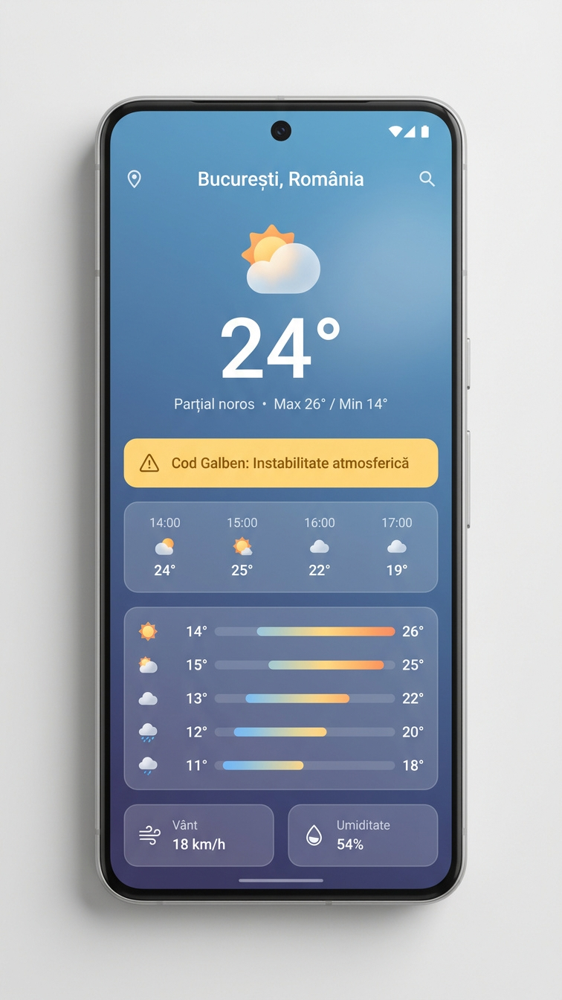

# ANM Meteo v1.0 — Aplicație Android Nativă (Material 3 & Jetpack Compose)

Aplicație Android modernă pentru consultarea datelor meteorologice oficiale **ANM (Administrația Națională de Meteorologie)** din România: starea vremii pe stații, prognoza pe 7 zile, avertizări generale și **nowcasting** în timp real, hartă radar națională și widget-uri interactive pentru ecranul principal.



---

## Noutăți în versiunea 1.0.0

### 1. Design Vizual & UI / UX (Material 3)
- **Temă dinamică atmosferică & Dark/Light Mode:** Culorile și gradienții de fundal se adaptează automat la ora din zi (zi/noapte) și la starea vremii (senin, noros, ploaie, furtună, ninsoare, ceață), cu comutator rapid în bara de sus (`Automat`, `Întunecat`, `Luminos`).
- **Set extins de iconițe meteo animate:** 11 iconițe vectoriale dedicate (inclusiv variante distincte zi/noapte, parțial noros, lapoviță, vânt puternic) cu micro-animații fluide în Jetpack Compose.
- **Card Hero & Navigare prin glisare (`HorizontalPager`):** Afișare clară a temperaturii curente, temperaturii resimțite (*„Se simte ca...”*), extremelor zilei și glisare orizontală între stația curentă și orașele favorite.
- **Bannere expandabile pentru avertizări ANM:** Carduri evidențiate cromatic (**Cod Galben**, **Cod Portocaliu**, **Cod Roșu**, **Informare**) afișate imediat sub temperatura curentă.
- **Prognoză orară & pe 7 zile cu bare de gradient termic:** Evoluție orară pe 12 ore și prognoză zilnică cu bare vizuale de amplitudine termică.
- **Grid de indicatori secundari (2×2):** Viteza și descrierea Beaufort a vântului, umiditate + punct de rouă, presiune atmosferică + tendință, orele astronomice de răsărit/apus și indicele UV estimat.
- **Widget-uri modernizate (Compact & Expandat):** Colțuri rotunjite adaptative, buton de **actualizare manuală** direct pe widget și insignă vizuală atunci când există o avertizare meteo activă.

### 2. Arhitectură & Funcționalități
- **Arhitectură MVVM & Clean Layers:** Cod modularizat pe pachete (`domain`, `data`, `ui`, `worker`, `widget`, `notification`) cu flux unidirecțional de date (`StateFlow`).
- **Mod Offline & Cache inteligent:** Salvarea locală a ultimelor date valide cu timestamp (`DataStore` + cache JSON), astfel încât aplicația și widget-urile rămân funcționale fără conexiune la internet.
- **Sincronizare în fundal & Notificări pentru alerte ANM (`WorkManager`):** Verificare periodică la fiecare 15 minute a fluxurilor ANM și trimitere de notificări push locale atunci când apare o avertizare nouă.
- **42 de stații meteo ANM verificate:** Tabel extins cu coordonate GPS exacte și județe pentru localizare rapidă.
- **Suite de teste unitare JUnit:** Teste automate pentru parsarea JSON-urilor ANM și calculele meteorologice/astronomice (`./gradlew testDebugUnitTest`).

---

## Structura Proiectului

```text
app/src/main/java/ro/anmmeteo/app/
├── AnMMeteoApplication.kt          # Inițializare canal notificări & WorkManager
├── MainActivity.kt                 # Entry-point Edge-to-Edge Compose
├── domain/
│   ├── model/WeatherModels.kt      # Modele de domeniu și UI State
│   └── util/WeatherMath.kt         # Calcule meteo (feels-like, UV, răsărit/apus, Haversine)
├── data/
│   ├── local/
│   │   ├── VerifiedStations.kt     # 42 stații ANM cu coordonate GPS și județ
│   │   ├── PreferencesStorage.kt   # Persistență Jetpack DataStore
│   │   └── OfflineCacheStorage.kt  # Cache local cu expirare și suport offline
│   ├── remote/AnmApiService.kt     # Client OkHttp și parsere JSON ANM v2
│   └── repository/WeatherRepository.kt
├── notification/
│   └── AlertNotificationHelper.kt  # Notificări sistem pentru Cod Galben/Portocaliu/Roșu
├── worker/
│   └── WeatherSyncWorker.kt        # Sincronizare periodică în fundal + refresh widget
├── widget/
│   └── WeatherWidgetProvider.kt    # Widget compact & expandat cu buton refresh
└── ui/
    ├── theme/                      # Material 3 Color, Type, Theme dinamic
    ├── components/                 # Iconițe animate, bare termice, carduri UI
    ├── screens/                    # Home, Stații, Radar ANM, Alerte
    └── viewmodel/WeatherViewModel.kt
```

---

## Construire în Codemagic sau Local

### Codemagic CI/CD
Fișierul `codemagic.yaml` este gata configurat cu două fluxuri:
- **`android-debug`**: Rulează testele unitare (`testDebugUnitTest`), analiza statică (`lintDebug`) și generează `app-debug.apk`.
- **`android-release`**: Rulează testele unitare și generează `app-release.apk`.

### Local (Android Studio / CLI)
```bash
gradle wrapper --gradle-version 8.9
./gradlew testDebugUnitTest assembleDebug
```
